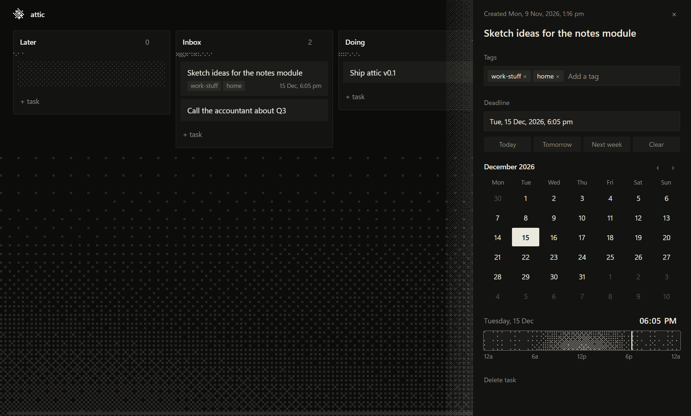

# attic

**The age of personal software is here.**

Attic is a place for your work that you own and reshape yourself. Today it is a small, local-first kanban board. Over time it is meant to become software you grow on the go with whatever coding agent you already use, such as Claude Code, Hermes, or anything else.



> **Very early.** Only the kanban board exists so far. Expect things to change and break.

## The idea

Most software makes you fit its idea of how work should go. Coding agents change that: describing the tool you want is now close to having it.

Attic starts from that. It aims to be one home for your tasks, notes and whatever else you need to keep track of, written so an agent can read it, understand it and change it for you. You ask for a view, a workflow or a whole new tool, and your copy becomes that. Nobody else's roadmap decides.

## What works today

- Columns you can create, rename, reorder and delete
- Tasks you can drag within and between columns, or move with `Alt` + arrow keys
- Tags, with suggestions from tags you already use
- A deadline for each task, set with a month calendar and a time-of-day bar
- The date and time each task was created
- Undo after deleting a task or column
- A quiet dithered look throughout, rendered from a single Bayer matrix

Your board is a plain JSON file on your own machine, with one backup per day. There is no account, cloud or telemetry.

## Run it

You need Windows 10 or 11, [Node.js](https://nodejs.org) 22 or newer, and Microsoft Edge.

```sh
git clone https://github.com/notnick2/attic.git
cd attic
npm start
```

There are no dependencies to install for this. Attic opens in its own window, backed by a small local server that listens only on `127.0.0.1` and exits when you close the window.

Your data lives in `%APPDATA%\Attic\data\board.json`. Set `ATTIC_HOME` to keep it somewhere else, and `PORT` to change the default port of `4477`.

## Make it yours

Open this folder in your coding agent and ask for what you want. [AGENTS.md](AGENTS.md) gives it the layout and the rules of the codebase.

The code is deliberately plain so that this works well: vanilla JavaScript, no framework and no build step. Save a file, reload the window, and see the change.

| Path | What it does |
| --- | --- |
| `public/app.js` | The board: rendering, drag and drop, saving |
| `public/detail.js` | The task panel: text, tags, deadline |
| `public/calendar.js` | The date and time picker |
| `public/dither.js` | All dithering: animated fields, tiles, dissolves |
| `public/bridge.js` | Connects the interface to where data is stored |
| `server.js` | The local server and window launcher |
| `store.js` | Reads and writes the board file, with backups |

## Where it's going

None of this is built yet:

- More than tasks: notes and other kinds of things worth keeping
- A clear way for any agent harness to read your data, act on it and extend the app
- Support beyond Windows
- A proper installable desktop app. `main.js` is an early Electron shell that has not been run yet, because an unsigned `.exe` is blocked by Windows Smart App Control. Attic opens in an Edge app window for now.

## Contributing

Issues and pull requests are welcome. The project is young, so please open an issue before starting anything large.

## License

[MIT](LICENSE)
